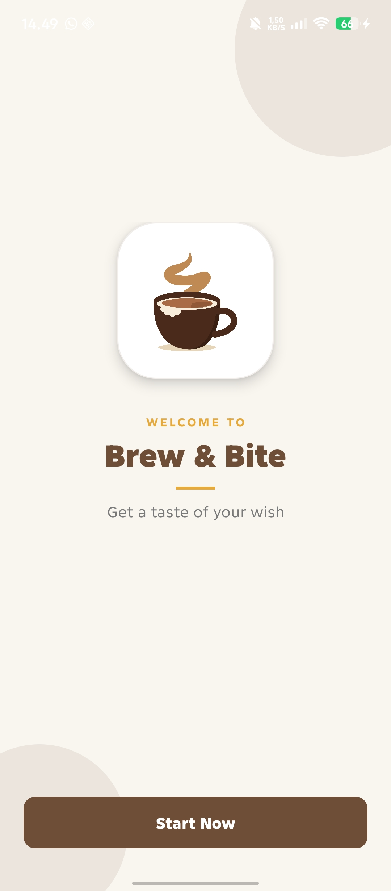
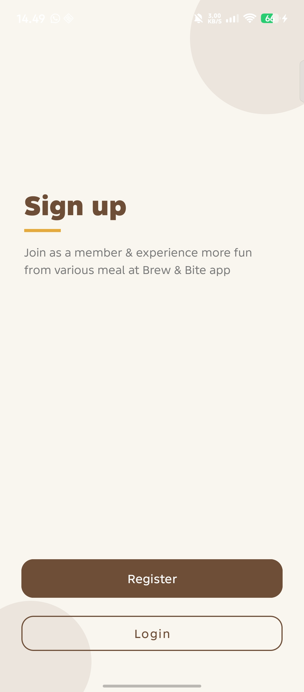
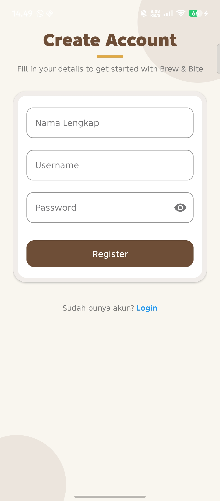
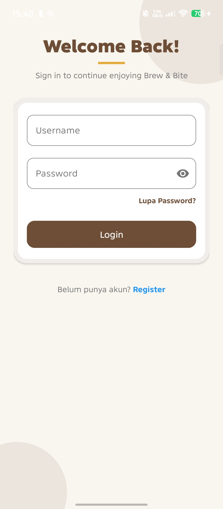
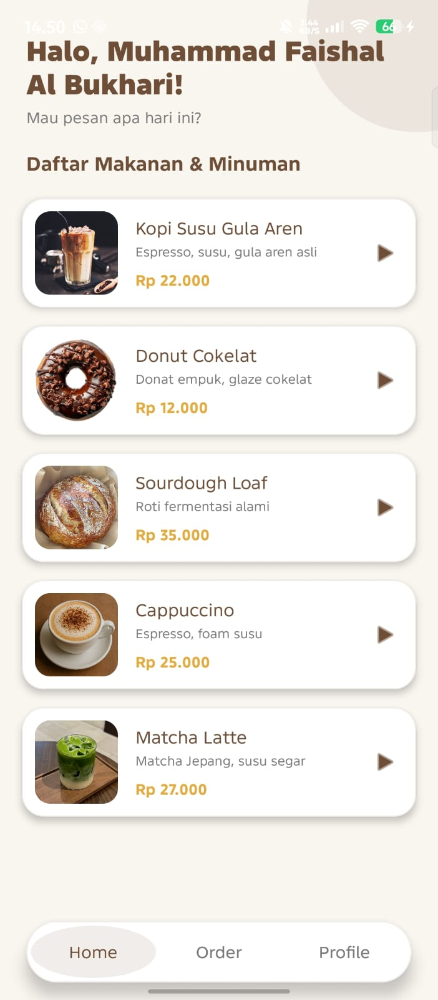
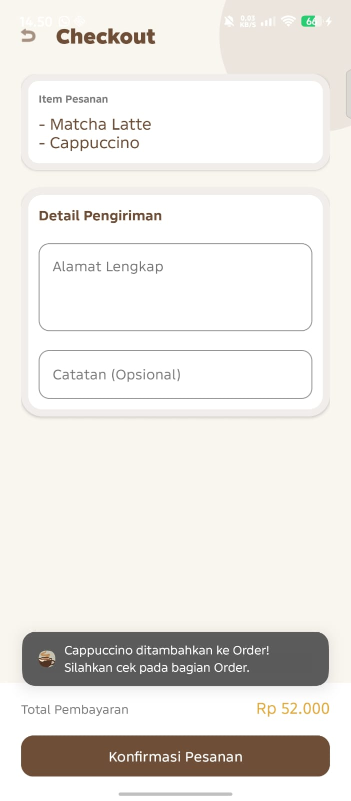
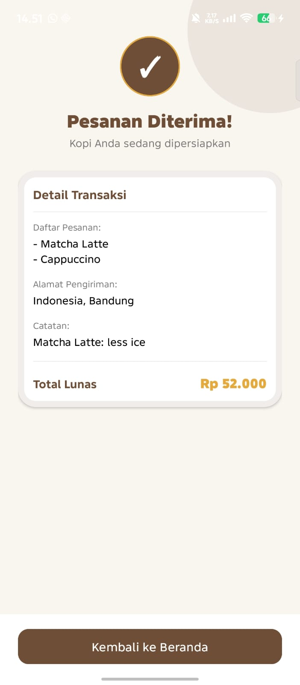
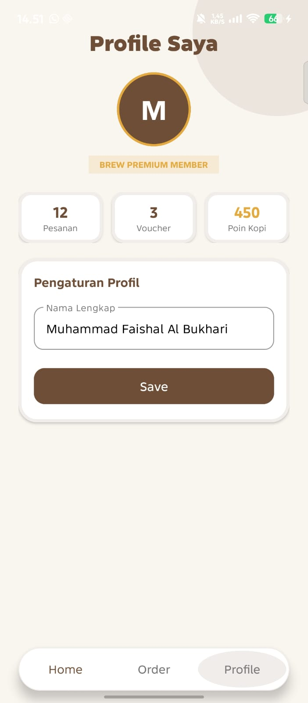

# ☕ Brew & Bite 

Aplikasi pemesanan makanan dan minuman berbasis Android native dengan skema warna kopi (*Coffee-themed Palette*).

Proyek ini dibangun menggunakan **Kotlin** dan **XML (ConstraintLayout)** untuk memenuhi tugas mata kuliah Pemrograman Aplikasi Mobile (PAM).

---

## 📸 Tampilan Aplikasi (Screenshots)

|           Splash Screen           |              Sign Up               |              Register               |             Login               |
|:---------------------------------:|:----------------------------------:|:--------------------------------:|:----------------------------------:|
|  |  |   |  |

|           Home Menu            |             Order              |              Konfirmasi Pesanan               |               Profile               |
|:------------------------------:|:------------------------------:|:---------------------------------------------:|:-----------------------------------:|
|   |  |  |  |

---

## ✨ Fitur Utama

- **Autentikasi Pengguna**: Layar Splash, Login, dan Register dengan validasi input dasar.
- **Daftar Menu Interaktif**: Menampilkan daftar produk menggunakan `RecyclerView` dan `ConstraintLayout`.
- **Sistem Order Multi-Item (`CartManager`)**: Menggunakan arsitektur *Singleton Object* untuk menampung banyak item pesanan sekaligus dari katalog.
- **Kalkulasi Total Otomatis**: Menghitung ringkasan item dan akumulasi harga secara real-time di halaman *Checkout*.
- **Konfirmasi & Resi Pesanan**: Halaman ringkasan sukses transaksi (*Success/Receipt Screen*) yang menampilkan alamat, catatan, dan rincian pembayaran.
- **Profil Pengguna**: Manajemen profil interaktif dengan dukungan *Initial Avatar* dinamis.
- **Custom Floating Bottom Navigation**: Tab navigasi kustom 3 halaman (Home, Cart, Profile) yang mulus tanpa kedip (*smooth transition*).

---

## 🛠️ Teknologi & Stack

- **Bahasa Pemrograman**: Kotlin
- **UI Framework**: Android XML (ConstraintLayout, ScrollView, LinearLayout)
- **Design System**: Material Design Components (`MaterialCardView`, `MaterialButton`, `TextInputLayout`)
- **List Processing**: `RecyclerView` & Custom Adapter (`MenuAdapter`)
- **Data Management**: State Management berbasis Singleton Object (`CartManager`)
- **Navigasi**: `Intent` berbasis Data Passing (`putExtra`) & Flag Clearing (`FLAG_ACTIVITY_CLEAR_TOP`)
- **IDE**: Android Studio Quali 3

---

## 🎨 Palet Warna (Color Palette)

| Warna | Hex Code | Penggunaan |
|---|---|---|
| **Coffee Brown** | `#6F4E37` | Warna utama, Header, Tombol Utama, Teks Judul |
| **Warm Amber** | `#E5A93C` | Aksen warna, Poin Kopi, Total Harga |
| **Off White** | `#F9F6F0` | Latar belakang (*Background*) aplikasi |
| **Pure White** | `#FFFFFF` | Latar belakang Card / Kontainer |

---

## 🚀 Cara Menjalankan Aplikasi

1. **Clone Repository Ini**
   ```bash
   https://github.com/Jhamax/uts_pam.git
## 🪜 Alur Penggunaan Aplikasi (User Flow)

Untuk mencoba seluruh fitur aplikasi secara runtut, ikuti alur penggunaan berikut:

1. **Splash Screen**: 
   - Saat aplikasi dibuka pertama kali, halaman Splash akan muncul selama beberapa detik sebelum otomatis mengarah ke Start Page.
2. **Autentikasi (Login & Register)**:
   - Jika belum memiliki akun, klik teks **Register** untuk membuat akun baru.
   - Pada halaman Login, masukkan **Username** (nama ini akan digunakan sebagai nama profil dan sapaan di utama) dan **Password**, lalu klik **Login**.
3. **Eksplorasi Katalog Menu (Home)**:
   - Di halaman utama, pengguna disambut dengan sapaan nama pengguna (`Halo, [Username]!`).
   - Tekan/klik item makanan atau minuman pada daftar `RecyclerView` untuk memasukkannya ke dalam list order.
4. **Kelola Order (Order)**:
   - Klik tab **Order** pada bar navigasi di bagian bawah.
   - Halaman ini akan menampilkan daftar menu yang telah dipilih beserta akumulasi **Total Pembayaran** yang dihitung secara otomatis.
5. **Checkout & Pengisian Data**:
   - Masukkan **Alamat Lengkap** (wajib) dan **Catatan Pesanan** (opsional).
   - Klik tombol **Konfirmasi Pesanan**.
6. **Resi / Bukti Transaksi (Confirmation)**:
   - Layar sukses akan menampilkan detail transaksi: daftar item, alamat pengiriman, catatan, dan total tagihan lunas.
   - List order akan otomatis dikosongkan.
   - Klik **Kembali ke Beranda** untuk melanjutkan transaksi baru.
7. **Profil Pengguna**:
   - Klik tab **Profile** pada navigasi bawah untuk melihat status *Brew Premium Member*, statistik pesanan, serta mengubah nama pengguna.
